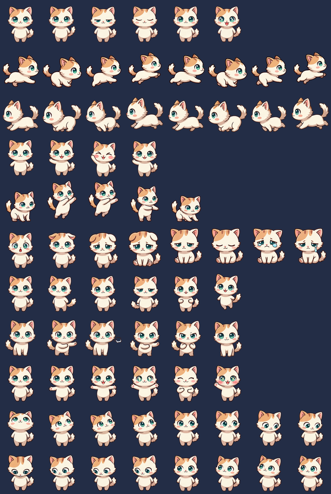
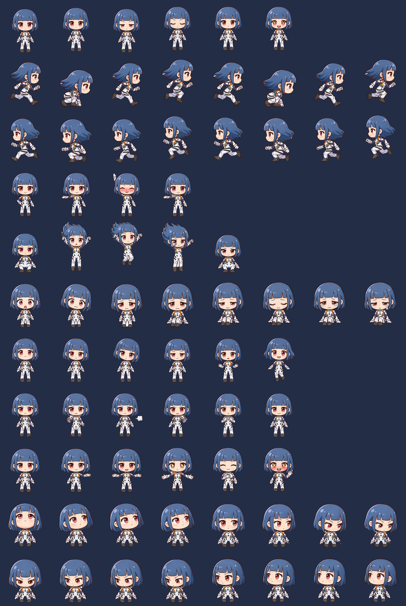
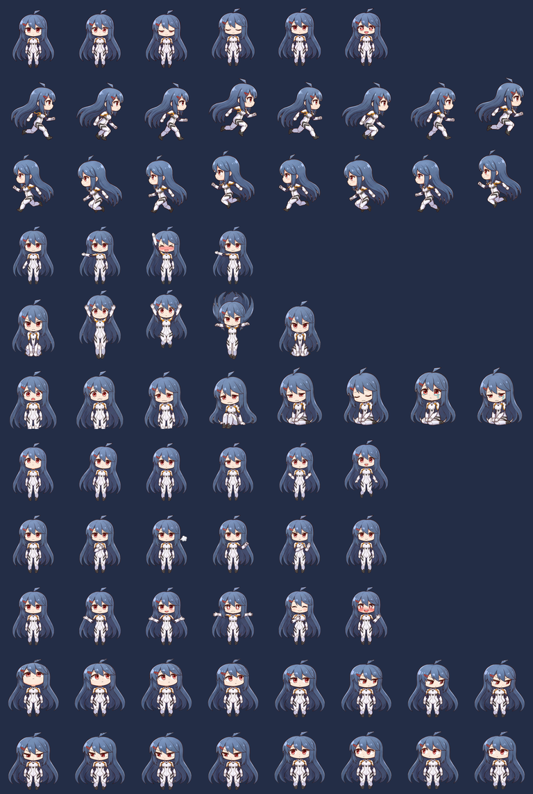

# Anime Pet Forge

**原創動漫風 MiniMax Pet 桌寵 + 一條可重複使用嘅生產 pipeline。**

用 AI 生成風格一致嘅 MiniMax Pet v2 桌寵，最難嘅唔係畫，係令 **73 格獨立生成出嚟嘅圖** 睇落似同一個角色、同一個大小、同一條腳底線、而且冇一格爆格。呢個 repo 就係將呢件事變成機械流程。

---

## 三隻寵物

| Pet | id | 圖集 | 大小 | Validator |
|---|---|---|---|---|
|  | `anime-cat-pet` | 73 格 | 2.52 MiB | `ok: true` · 0 warnings |
|  | `eva-rei-pet` | 73 格 | 2.38 MiB | `ok: true` · 0 warnings |
|  | `eva-rei-long-pet` | 73 格 | 2.55 MiB | `ok: true` · 0 warnings |

全部符合 MiniMax Pet v2 規格：**1536 × 2288**、8 欄 × 11 行、每格 **192 × 208**、9 條動畫軌（57 格）+ 16 個視線方向（73 格總數）、靜態 8-bit RGBA 非交錯 PNG、真 alpha、≤ 8 MiB。

三隻都可以直接下載 `pet.json` + `spritesheet.png`，喺 MiniMax Pet App 用「外觀 → 匯入寵物」匯入。

---

## Skill：`anime-pet-forge`

```
skill/anime-pet-forge/
  SKILL.md              # 工作流程
  scripts/
    make_ref_request.py # (1) 角色設定圖 request
    make_batch_request.py# (2) 姿勢 sheet request（支援 per-sheet 變體）
    fetch_asset.sh      # (3) 由 node_id 落載生成結果
    cutout.sh           # (3) 去背 → 真 alpha PNG
    assemble_atlas.py   # (4) 切格 + 歸一化 + 貼入 1536×2288 圖集
    validate.sh         # (5) 行官方 validator
  references/
    atlas-spec.md       # v2 規格重點
    character-config.md # char.json 完整 schema
    pitfalls.md         # 12 個真實踩過嘅坑
  templates/
    char.example.json   # 新寵物起手式
    pet.example.json
```

### 快速開始

```sh
# 0) 複製模板
cp skill/anime-pet-forge/templates/char.example.json my-pet/char.json

# 1) 角色設定圖（text-only 設計稿）
python3 skill/anime-pet-forge/scripts/make_ref_request.py \
        --char my-pet/char.json --out req/ref.json
mcode-tools connector call connector__matrix__generate_image --args-file req/ref.json

# 2) 姿勢 sheet（每批之前要重新上載 reference，URL 會過期）
url=$(mcode-tools upload_temp_url my-pet/refs/reference.jpg \
      | python3 -c "import sys,json;print(json.load(sys.stdin)['temp_url'])")
python3 skill/anime-pet-forge/scripts/make_batch_request.py \
        --char my-pet/char.json --batch 1 --ref-url "$url" --out req/batch1.json
mcode-tools connector call connector__matrix__generate_image --args-file req/batch1.json

# 3) 落載 + 去背
bash skill/anime-pet-forge/scripts/fetch_asset.sh <node_id> sheets/sheet-idle.jpg
bash skill/anime-pet-forge/scripts/cutout.sh sheets/sheet-idle.jpg sheets/sheet-idle-cut.png

# 4) 組裝
python3 skill/anime-pet-forge/scripts/assemble_atlas.py \
        --char my-pet/char.json --from-sheets sheets --out my-pet --dump my-pet/frames

# 5) 驗證
bash skill/anime-pet-forge/scripts/validate.sh my-pet
```

完整流程同每一步嘅理由見 [`skill/anime-pet-forge/SKILL.md`](skill/anime-pet-forge/SKILL.md)。

---

## 點解可以重現

每隻寵物都帶住 **73 張單格 192 × 208 PNG**（`frames/`）。組裝器有兩條路徑：

| 路徑 | 用途 | 結果 |
|---|---|---|
| `--from-sheets` | 從 4K 原圖 sheet 重新切格、歸一化 | 逐像素重現 |
| `--from-frames` | 直接貼現成單格 | 逐像素重現 |

兩條路徑對三隻寵物都驗證過 **diff = 0**，即係任何人 clone 完都可以喺唔使重新生成任何一張圖嘅情況下，重新砌出完全相同嘅圖集。

`char.json` 亦都係 **lossless** 嘅：由佢重建出嚟嘅 30 條 prompt，同當初真正送去生成嘅 prompt **逐字一致**（30/30 exact match）。

---

## Repo 結構

```
anime-pet-forge/
├── README.md
├── INSTALL.md
├── LICENSE
├── skill/anime-pet-forge/       # 可安裝嘅 skill
├── anime-cat-pet/               # 奶黃貓貓
├── eva-rei-pet/                 # 零波短髮版
├── eva-rei-long-pet/            # 零波長髮版
└── docs/lessons.md              # 呢輪製作嘅完整紀錄
```

每隻寵物：

```
my-pet/
  pet.json          # App metadata
  spritesheet.png   # 1536×2288 成品
  atlas-preview.png # 逐格預覽
  char.json         # 生產設定（prompt + 組裝參數）
  prompts.json      # 每張 sheet 逐字 prompt 記錄
  frames/           # 73 張單格 PNG
  refs/             # 角色設定原圖
  README.md
```

`_work/` 放住 4K 原圖 sheet 同生成 request（含簽名 URL，**唔會入 git**）。

---

## 關於 IP

三隻寵物全部係**原創 chibi 重新設計**，唔含任何官方素材、logo 或者可讀文字。EVA 角色屬第三方 IP，呢度只作同人技術示範用途。

---

## License

MIT —— 見 [`LICENSE`](LICENSE)。

生成出嚟嘅圖屬各角色嘅作者；本 repo 只提供 pipeline 同成品。
